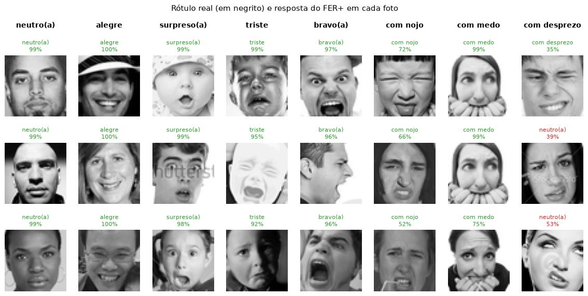
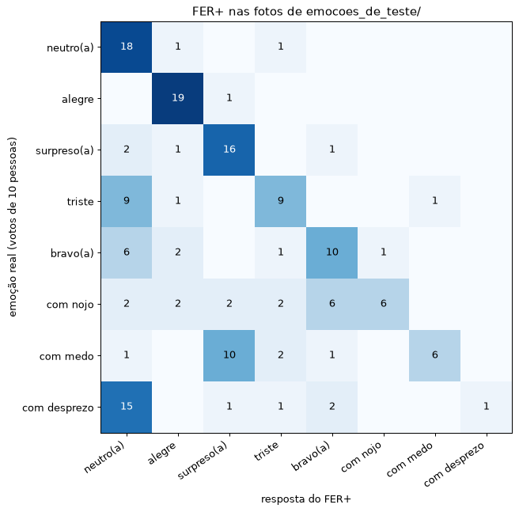

# Reconhecimento facial com CNN

Uma Rede Neural Convolucional (CNN) treinada **do zero** que reconhece os integrantes do grupo pelo rosto.
O repositório tem o pipeline completo em Python (pré-processamento, divisão, aumento de dados, CNN, treino,
métricas e imagens intermediárias) e um **site local**, servido por Node.js, com:

- **no topo:** o reconhecimento **ao vivo pela webcam**, usando o modelo treinado, com a **emoção** de cada pessoa
  (alegre, triste, bravo(a), com medo...) embaixo do nome;
- **logo abaixo:** a **documentação** passo a passo, com o código real de cada etapa, as imagens
  intermediárias e as métricas do último treino.

O notebook original do Google Colab está em [`notebooks/reconhecimento_facial_cnn.ipynb`](notebooks/reconhecimento_facial_cnn.ipynb)
e é a referência do pipeline: mesma lógica, mesmos parâmetros e mesmos nomes de funções.

## Como as partes se conversam

```
navegador (webcam, desenho)  --HTTP-->  servidor.js (Node + Express)  --stdin/stdout, JSON por linha-->  src/servico.py (Python + CNN)
```

- O **Node** cuida de todo o HTTP: entrega o site, salva as fotos da coleta, lê os resultados e o código da documentação.
- O **Python** cuida só da rede neural. Ele não é um servidor web: o Node abre **um** processo `python -m src.servico`,
  que carrega o modelo uma vez e responde a cada pedido com uma linha de JSON. Assim o reconhecimento ao vivo usa
  exatamente o mesmo `preprocessar` do treino.

## Estrutura

```
├── servidor.js             servidor Node (Express): site, rotas da API e ponte com o Python
├── package.json            dependência do Node (express)
├── dataset/<nome>/         fotos de cada integrante (o nome da pasta é o rótulo)
├── rostos_de_fora/         1500 fotos públicas de pessoas de fora do grupo (ensinam a rede a reconhecer um desconhecido)
├── emocoes_de_teste/       160 fotos públicas com a emoção rotulada (20 por emoção), para testar o modelo pronto de emoções
├── modelo/                 gerado pelo treino: modelo_cnn.keras, classes.json, limiar.json, resultados.json
├── src/
│   ├── config.py           todos os parâmetros (IMG_SIZE, EPOCAS, BATCH, SEED, LIMIAR...)
│   ├── dados.py            ler_imagem (com correção EXIF), listar_dataset, listar_rostos_de_fora, imagem_de_dataurl
│   ├── preprocessamento.py recorte_rosto, para_cinza, redimensionar, equalizar_histograma, mascara_oval, preprocessar
│   ├── divisao.py          treino/validação/teste por blocos de fotos seguidas
│   ├── ninguem.py          classe "ninguém": recortes de fundo usados como exemplos de câmera vazia
│   ├── desconhecidos.py    desconhecidos: alvo "em dúvida" para os rostos de fora e escolha do limiar de confiança
│   ├── aumento.py          aumentar (espelho, deslocamento, máscara encolhida, contraste, brilho, ruído), variar_cena, colar_no_cenario
│   ├── modelo.py           construir_cnn
│   ├── metricas.py         matriz de confusão, VP/FP/FN/VN, precisão, recall, F1, especificidade, acurácia
│   ├── visualizacoes.py    imagens intermediárias em PNG
│   ├── reconhecimento.py   regioes_da_tela, reconhecer_quadro, grad_cam, ampliar_bilinear
│   ├── robustez.py         teste de troca de fundo (a rede segue o rosto ou o cenário?)
│   ├── emocao.py           emoção do rosto com o modelo pronto FER+ (ONNX): baixar, preparar a entrada, classificar
│   ├── teste_emocao.py     testa o FER+ nas fotos de emocoes_de_teste/ (tabela, exemplos e matriz de confusão)
│   ├── servico.py          processo Python aberto pelo servidor.js: recebe pedidos e roda a CNN
│   └── treinar.py          executa o pipeline completo
├── web/                    site: index.html, css/, js/, img/resultados/ (PNGs gerados pelo treino), img/emocao/ (figuras do teste do FER+)
├── tests/                  testes com pytest
└── notebooks/              notebook original
```

## Como usar

### 1. Pré-requisitos e ambiente virtual

- Python **3.10 a 3.13** (testado com Python 3.13 e TensorFlow 2.20);
- Node.js **18 ou mais novo** (testado com Node 22).

Na pasta do repositório, crie o ambiente virtual do Python:

```bash
python -m venv .venv

# Windows (PowerShell)
.venv\Scripts\Activate.ps1
# Linux / macOS
source .venv/bin/activate
```

### 2. Instalar as dependências

```bash
pip install -r requirements.txt   # Python: TensorFlow, NumPy, Pillow, matplotlib, onnxruntime, pytest
npm install                       # Node: Express
```

O servidor Node usa sozinho o Python do `.venv` (onde está o TensorFlow). Se o ambiente estiver em outro lugar,
indique o caminho do Python na variável de ambiente `PYTHON`.

### 3. Coletar as fotos

Cada integrante precisa de uma pasta `dataset/<nome>/` com as fotos dele. Há duas formas:

- **Pelo site:** rode `npm start`, abra `http://localhost:5000` e use a área **“Preparar o modelo”**, passo 1
  (ela abre sozinha enquanto não houver modelo treinado). Digite o nome (ou clique em um nome já cadastrado),
  clique em “Iniciar captura”: depois de uma contagem de 3 s, a página tira N fotos (padrão 80, uma a cada 250 ms)
  e salva em `dataset/<nome>/`, continuando a numeração.
- **Copiando arquivos:** coloque fotos `.jpg`, `.jpeg`, `.png` ou `.heic` (iPhone) em `dataset/<nome>/`. Os arquivos são lidos em
  ordem alfabética, que deve ser a ordem em que foram tirados (ex.: `ana_0000.jpg`, `ana_0001.jpg`...).

Dicas para a rede aprender o rosto, e não o fundo:

- façam **3 ou mais sessões** por pessoa, em **lugares e iluminações diferentes**;
- fotografem **todos nos mesmos lugares**: se cada pessoa tiver um cenário só dela, o cenário vira uma pista mais fácil que o rosto;
- mantenham o rosto dentro do oval e mexam levemente a cabeça durante a captura;
- tirem fotos **perto e longe** da câmera: se uma classe só aparece de perto, a distância vira pista;
- **confiram as pastas antes de treinar**: cada pasta deve ter só fotos daquela classe (a rede aprende os erros de rótulo também).
  Fotos que não servem podem ir para `dataset/_descartadas/`, que o treino ignora;
- (opcional, mas ajuda muito) coletem fotos com o nome **`ninguem`**, com a câmera apontada para os lugares vazios
  (cadeira, parede). Elas viram a classe “ninguém”, que a rede responde quando não há pessoa no oval. Mesmo sem
  essa pasta, o treino cria exemplos de “ninguém” a partir do fundo das fotos dos integrantes;
- (opcional) coletem fotos de **pessoas de fora do grupo** (amigos, familiares) com o nome **`desconhecido`**, no mesmo
  lugar das fotos de vocês. Elas não viram uma classe: juntam-se aos rostos públicos de `rostos_de_fora/`
  (veja [Desconhecidos](#desconhecidos));
- juntem **cerca de 150 a 300 fotos por pessoa**, em **quantidades parecidas** entre as pessoas;
- nomes de pasta só com letras minúsculas sem acento, números, `_` ou `-` (pastas que começam com `.` ou `_` são ignoradas).

### 4. Treinar

**Pelo site (mais fácil):** na área “Preparar o modelo”, passo 2, a página mostra quantas fotos cada integrante tem
e avisa o que falta (pelo menos 2 integrantes e 3 fotos por pessoa). Clique em **Treinar modelo** e acompanhe a
barra de progresso (etapa, época e acurácia na validação) e o log. Marcando **“Treinar automaticamente depois da
coleta”** no passo 1, o treino começa sozinho quando as fotos são salvas. Sem GPU, o treino leva alguns minutos
(mais fotos, mais tempo); dá para cancelar a qualquer momento sem perder o modelo anterior.

**Pelo terminal:** é o mesmo comando que o site usa por trás.

```bash
python -m src.treinar
```

O script faz, na ordem: leitura (fotos dos integrantes e rostos de fora do grupo) → pré-processamento (recorte do
rosto e máscara oval) → divisão em treino/validação/teste (por blocos de fotos seguidas) + exemplos de “ninguém” →
aumento de dados → montagem da CNN → treino (até 60 épocas, com EarlyStopping) → avaliação no teste, teste de troca de
fundo e escolha do limiar de “desconhecido” → imagens intermediárias. Com os 1500 rostos de fora, o treino sem GPU
leva em torno de 15 minutos. No fim, imprime as métricas no terminal e salva:

| Arquivo | Conteúdo |
|---|---|
| `modelo/modelo_cnn.keras` | a rede treinada |
| `modelo/classes.json` | os nomes dos integrantes, na ordem dos rótulos |
| `modelo/limiar.json` | o limiar de confiança escolhido pelo treino (abaixo dele, “desconhecido”) |
| `modelo/resultados.json` | métricas, matriz de confusão, histórico do treino, divisão dos dados, camadas e o teste dos desconhecidos |
| `web/img/resultados/*.png` | fotos originais, etapas do pré-processamento, aumento, curvas, matriz, métricas, erros, mapas de características, Grad-CAM, teste de troca de fundo e confiança para integrantes × rostos de fora |

Sempre que coletarem fotos novas, rodem o treino de novo. O servidor percebe o modelo novo sozinho (não precisa reiniciar).

### 5. Abrir o site

```bash
npm start
```

O terminal mostra `Site em http://localhost:5000` e, alguns segundos depois, `Python pronto para receber pedidos.`
(é o tempo de carregar o TensorFlow). Abra **http://localhost:5000**. Clique em “Ligar webcam” e permita o acesso à câmera.
O navegador só libera a webcam em `localhost` ou em HTTPS, por isso o servidor escuta apenas em `127.0.0.1`.

- **1 pessoa:** o oval central é o mesmo recorte e a mesma máscara das fotos de treino (é quando a rede funciona melhor).
- **2 pessoas:** a tela é dividida em duas faixas lado a lado, cada uma com o seu oval; cada pessoa fica dentro de um.
- **Ninguém:** se a rede achar que o oval está vazio, ele fica cinza com “ninguém”.
- **Limiar:** abaixo dele, o oval fica vermelho com “desconhecido”. O valor inicial é o que o treino escolheu
  (veja [Desconhecidos](#desconhecidos)); o controle deslizante ajusta na hora, sem retreinar: subam se um estranho
  for aceito, desçam se um integrante virar “desconhecido”.
- **Emoção:** embaixo de cada oval com uma pessoa (reconhecida ou “desconhecido”) aparece, numa faixa roxa, a emoção
  mais provável: alegre, triste, bravo(a), com medo, neutro(a), surpreso(a), com nojo ou com desprezo (média dos últimos 5 quadros).
- **Ver o que a rede vê:** congela o quadro e mostra as etapas do pré-processamento, o Grad-CAM, as probabilidades
  de cada integrante e as de cada emoção.

### Desconhecidos

O softmax sempre distribui 100% entre as classes que conhece. Treinada só com os integrantes, a rede dava o nome de
um deles para **qualquer** rosto, quase sempre com perto de 100% de confiança: no teste em que um integrante fica de
fora do treino, ele era aceito como membro em cerca de 80% das fotos, e nenhum limiar resolvia.

A solução está em `src/desconhecidos.py`:

- **Rostos de fora no treino.** A pasta `rostos_de_fora/` tem 1500 fotos públicas, cada uma de uma pessoa diferente
  (do conjunto *Labeled Faces in the Wild*; detalhes em [`rostos_de_fora/LEIAME.md`](rostos_de_fora/LEIAME.md)). Fotos
  coletadas com o nome `desconhecido` entram junto. São só **dados**: a CNN continua sendo treinada do zero.
- **O alvo é a dúvida.** Esses rostos não ganham uma classe. Para eles, a rede é cobrada a dividir a resposta por
  igual entre as classes; para os integrantes, a dar 100% na classe certa. Assim a confiança só fica alta para quem é
  do grupo.
- **Rostos de fora no nosso cenário.** No aumento de dados, cada rosto de fora é colado, em tamanho e posição
  sorteados, sobre uma foto de “ninguém” (`colar_no_cenario`, em `src/aumento.py`). Sem isso a rede aprende o atalho
  “foto de webcam = integrante”, porque as fotos públicas têm enquadramento e nitidez diferentes das nossas.
- **O treino escolhe o limiar.** Nas fotos de validação, ele testa os limiares de 50% a 95% e fica com o que menos
  erra (integrante rejeitado ou rosto de fora aceito). O valor vai para `modelo/limiar.json` e vira a posição inicial
  do controle deslizante do site.

No mesmo teste de deixar um integrante de fora, com o limiar escolhido pelo treino (75%), a aceitação caiu de cerca de
80% para cerca de 5% em um caso e para 6–13% no outro (o mais difícil: uma pessoa pequena no quadro, no mesmo cômodo
das fotos de treino; o resultado varia de um treino para outro). Uma classe `desconhecido` comum foi testada e
descartada: a rede aprendia o atalho “foto de webcam = integrante” e ainda aceitava 71% em um dos casos. A seção 10 da documentação do site mostra o
resultado do último treino (rostos de fora que a rede nunca viu).

### Emoção (modelo pronto)

A emoção é a **única** parte que usa um modelo pré-treinado, como o trabalho permite: o **FER+** (Microsoft, formato
ONNX, executado com `onnxruntime`). Na primeira vez que o servidor abre, o arquivo (~35 MB) é baixado sozinho para
`modelo/emocao_ferplus.onnx`; para baixar antes, rode `python -m src.emocao`. O FER+ recebe um quadrado no mesmo
centro do oval, só que mais fechado no rosto (45% do menor lado, contra 60% da CNN), em cinza, 64×64, sem equalização
e sem máscara; a entrada da CNN não muda. No painel “Ver o que a rede vê”, a imagem com borda roxa é o que o FER+
recebe. **Quem é** a pessoa, o “desconhecido” e o “ninguém” continuam vindo só da nossa CNN. Sem internet, o site funciona normalmente, só sem a emoção.

#### Sobre o FER+

- **Origem:** Microsoft Research, artigo *Training Deep Networks for Facial Expression Recognition with Crowd-Sourced
  Label Distribution* (Barsoum et al., ICMI 2016, [arXiv:1608.01041](https://arxiv.org/abs/1608.01041)).
- **Dados:** as cerca de 35 mil fotos de rostos (48×48) do dataset FER2013, rerrotuladas pela Microsoft com
  **10 pessoas votando** na emoção de cada foto (rótulos em [microsoft/FERPlus](https://github.com/microsoft/FERPlus)).
  Por isso a saída é uma distribuição de probabilidades, que imita como os votos se dividiam.
- **Arquivo:** `emotion-ferplus-8.onnx`, do [ONNX Model Zoo](https://github.com/onnx/models/tree/main/validated/vision/body_analysis/emotion_ferplus);
  treinado no CNTK 2.5.1 e exportado com opset 8.
- **Entrada e saída:** um rosto 64×64 em cinza, com tons de 0 a 255 (o próprio modelo normaliza a entrada, com uma
  subtração e uma divisão logo no começo); a saída são 8 pontuações sem softmax (neutro, alegria, surpresa, tristeza,
  raiva, nojo, medo e desprezo), que transformamos em probabilidades com o nosso `softmax`.

**Arquitetura** (conferida no próprio arquivo): uma CNN no estilo VGG13, com **10 convoluções** e cerca de
**8,76 milhões de parâmetros**.

| Bloco | Camadas | Filtros |
|---|---|---|
| 1 | 2 convoluções 3×3 + max pooling + dropout | 64 |
| 2 | 2 convoluções 3×3 + max pooling + dropout | 128 |
| 3 | 3 convoluções 3×3 + max pooling + dropout | 256 |
| 4 | 3 convoluções 3×3 + max pooling + dropout | 256 |
| Densas | 4×4×256 → 1024 → 1024 (com dropout) → 8 saídas | — |

**Comparação com a nossa CNN:** as duas seguem a mesma ideia (convoluções → pooling → dropout → camadas densas →
uma saída por classe). A diferença é a escala: a nossa tem 4 convoluções e foi treinada do zero com algumas centenas
de fotos de cada integrante, então só conhece o grupo; o FER+ aprendeu com dezenas de milhares de rostos de pessoas
diferentes, por isso reconhece a expressão de qualquer pessoa. O nosso treino não altera o FER+: o arquivo dele nunca
é aberto pelo `python -m src.treinar`.

**Limitações:** os dados do FER+ são desbalanceados (muito mais rostos neutros e alegres do que com medo, nojo ou
desprezo), então na dúvida ele tende a responder neutro ou alegre. Medo × surpresa e triste × neutro são as confusões
mais comuns, e expressões sutis costumam sair “neutro”: para testar, exagerem a expressão, segurem por 2 segundos e
mantenham o rosto centralizado no oval, com luz de frente.

#### Teste com cada emoção

Na webcam só conseguimos encenar bem alegre, neutro, surpreso e com medo. Para documentar o FER+ respondendo às
**8 emoções**, a pasta `emocoes_de_teste/` tem 160 fotos públicas já rotuladas, 20 de cada emoção, sorteadas do
conjunto de **teste** do FER2013/FER+ (fotos que o FER+ não viu no treino; o sorteio não olhou a resposta do modelo —
detalhes em [`emocoes_de_teste/LEIAME.md`](emocoes_de_teste/LEIAME.md)). Como essas fotos já vêm recortadas no rosto,
elas não passam pelo nosso recorte: são só ampliadas de 48×48 para 64×64.

```bash
python -m src.teste_emocao
```

Para cada emoção, as 3 fotos em que o FER+ deu a maior probabilidade para a emoção certa (título verde = acertou,
vermelho = respondeu outra emoção):



| Emoção | Fotos | Acertos | Recall | Precisão | Erro mais comum |
|---|---|---|---|---|---|
| neutro(a) | 20 | 18 | 90% | 34% | alegre (1) |
| alegre | 20 | 19 | 95% | 73% | surpreso(a) (1) |
| surpreso(a) | 20 | 16 | 80% | 53% | neutro(a) (2) |
| triste | 20 | 9 | 45% | 56% | neutro(a) (9) |
| bravo(a) | 20 | 10 | 50% | 50% | neutro(a) (6) |
| com nojo | 20 | 6 | 30% | 86% | bravo(a) (6) |
| com medo | 20 | 6 | 30% | 86% | surpreso(a) (10) |
| com desprezo | 20 | 1 | 5% | 100% | neutro(a) (15) |



O FER+ acerta **85 das 160 fotos (53%)**. Ele reconhece todas as emoções em pelo menos uma foto, mas não por igual:
é forte em neutro, alegre e surpreso (80–95%), mediano em triste e bravo (cerca de metade) e fraco em nojo, medo e
desprezo, exatamente as emoções com poucas fotos no treino dele. Os erros seguem as confusões esperadas: medo vira
surpresa, nojo vira raiva, e triste, bravo e desprezo viram neutro. A precisão baixa do “neutro” vem daí: em cerca de
dois terços das vezes em que ele responde neutro, a foto era de outra emoção.

Esse teste é **equilibrado** de propósito (20 fotos de cada emoção), para cobrar todas igualmente. No conjunto de
teste na proporção original, em que neutro e alegre são a maioria, o mesmo modelo acerta cerca de 82% (3352 fotos,
medido uma vez com este mesmo código; essas fotos não estão no repositório).

Se o modelo ainda não foi treinado, o site avisa para rodar `python -m src.treinar` primeiro.

### 6. Testes

```bash
pytest
```

Testa o pré-processamento (formato `(96, 96, 1)` em `float32` entre 0 e 1, equalização sem NaN, recorte quadrado)
e as métricas (VP/FP/FN/VN, precisão, recall, F1, especificidade e acurácia contra valores calculados à mão),
além da entrada e do softmax da parte de emoção e da detecção de desconhecidos (alvo “em dúvida”, escolha do limiar
e pastas).

## Regras do trabalho

Não usamos bibliotecas auxiliares para o modelo nem para os tratamentos: nada de detector de rosto pronto
(OpenCV, dlib, face_recognition, MediaPipe), modelo pré-treinado, transfer learning, `ImageDataGenerator`,
camadas de aumento de dados do Keras ou scikit-learn. A única exceção, permitida pelo trabalho, é a **emoção**,
que vem do modelo pronto FER+. As fotos públicas de `rostos_de_fora/` são apenas dados de treino: nenhum peso pronto
é carregado na nossa CNN. As de `emocoes_de_teste/` servem só para testar o FER+ e não entram em nenhum treino.

| Etapa | Ferramenta |
|---|---|
| Abrir e salvar o arquivo .jpg/.png/.heic | `PIL` + `pillow-heif` para .heic (só transforma o arquivo em uma matriz de números) |
| Recorte, tons de cinza, redimensionamento, equalização, aumento de dados, divisão dos dados, alvo dos rostos de fora e escolha do limiar | **código próprio com NumPy** |
| Montar e treinar a CNN | TensorFlow/Keras, **sem modelo pré-treinado** |
| Matriz de confusão e métricas | **código próprio com NumPy** |
| Emoção do rosto (só ela) | modelo **pronto** FER+ (ONNX) com `onnxruntime` |
| Grad-CAM (mapa de calor) | **código próprio** sobre a nossa CNN; o TensorFlow só calcula o gradiente e a ampliação bilinear é NumPy |
| Gráficos e imagens intermediárias | `matplotlib` |
| Servidor local | Node.js com `Express` (a rede roda num processo Python aberto por ele) |
| Site e captura da webcam | HTML, CSS e JavaScript puros (`navigator.mediaDevices.getUserMedia`) |

## Privacidade

Este repositório guarda **fotos de rostos** dos integrantes. Recomendamos deixá-lo **privado** ou ter o
consentimento de todos antes de publicá-lo. Se a pasta `dataset/` passar de ~100 MB, usem
[Git LFS](https://git-lfs.com/) para as imagens (`git lfs track "dataset/**/*.jpg"`).
